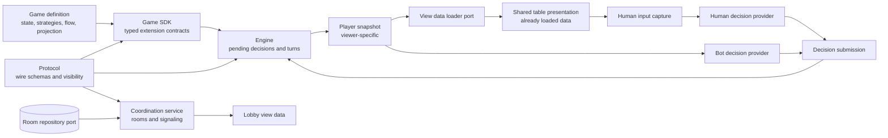
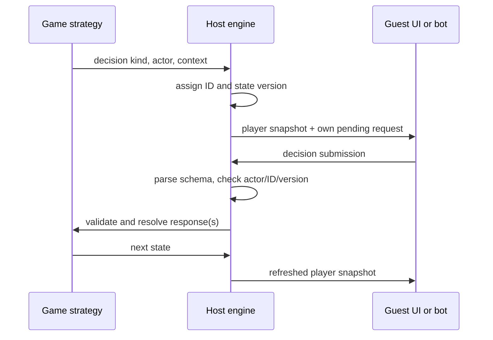
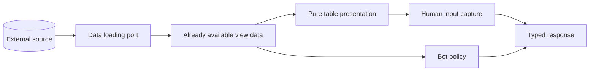

# Contract map

This is the entry point for reviewing the platform interfaces. The [JSON Schema](contracts.schema.json) describes the shared wire envelopes; each registered game supplies its own schemas for decision context, response, and player view. The [accepted architecture](superpowers/specs/2026-10-04-web-game-platform-design.md) explains the full product design.

## Ownership and relationships

The protocol is independent of the web framework, transport, and storage provider. AWS Lambda and DynamoDB implement the coordination ports later. The browser host runs the engine in the initial architecture; guests receive only projected snapshots. The UI presents data it has already received and captures a response. It does not retrieve game state or apply rules.

## Main areas

| Area | Owns | Depends on | Must not own |
| --- | --- | --- | --- |
| `packages/protocol` | Serializable decision, snapshot, room, membership-capability, signaling, and visibility contracts; runtime parsing | Zod | Game rules, rendering, persistence |
| `packages/game-sdk` | Typed game definition and strategy interfaces | Protocol | Turn orchestration, transport |
| `packages/engine` | Active decision groups, correlation, validation, response barriers, state versions, projection calls | SDK, protocol | A fixed list of game actions, UI |
| `services/coordination` | Room discovery and connection signaling through a repository port | Protocol | Hidden game state or rules |
| `packages/ui` | Render-ready table models and loaded-view port | Protocol | Room storage, authoritative state transitions |
| `packages/decision-providers` | Human input adapter and bot decision handlers using one submission contract | Protocol; injected human capture callback | Rules, authoritative state, transport |
| `apps/web` | Planned browser composition of these areas | Shared packages | Reimplementation of game rules |

## Decision and view protocol

`DecisionRequest<M>` is a discriminated union over a game's decision map `M`: each `kind` selects its own `context` type. `DecisionSubmission<M>` uses the same `kind` to select its `response` type. `createDecisionProtocol(codecs)` checks untrusted requests and submissions at runtime. A `PlayerSnapshot<M,V>` contains one viewer's projected `view` and only pending requests addressed to that viewer; `createSnapshotProtocol` verifies actor, table, and version correlation.

The JSON Schema records the shared envelope fields. Its generic `context`, `response`, and `view` fields are intentionally open: concrete game registrations provide their own Zod schemas. A complete game-specific wire schema can be exported when that game is registered. This avoids a platform-wide closed action enum.

## Lobby and signaling protocol

`RoomSummary` contains only public discovery metadata. Its server-assigned `hostId` is a routing identifier, not an authenticator. Room creation and a successful join return `RoomAccess`, which contains a server-assigned member ID and a 256-bit bearer capability. Create and join requests require a canonical 43-character base64url encoding of a client-generated 32-byte random idempotency key. The key is private bearer material: clients retain it for retries and must not log or publish it. The service hashes the key for storage and derives the room-scoped capability with HMAC using a stable deployment secret; membership records store only the capability's SHA-256 verifier. This lets the same private key recover the same access response after a lost reply without storing raw capabilities. The HMAC derivation secret must be shared by service replicas and kept outside the repository; rotation is deferred until a versioned migration is designed. Create and join requests do not accept host/player IDs, so a display name or guessed ID cannot claim an existing member.

Create idempotency records bind the key digest to the requested game and player limit for 24 hours. A retry with different settings is rejected. Host departure deletes the room and retires its unexpired create key in the same repository operation, so a delayed retry cannot silently create a replacement room; after expiry the key can start a new request. Each room retains up to 256 unique join-key digests, including retired tombstones after members leave. Active join retries replay before the capacity check; retired keys cannot claim another seat, and new joins are rejected when that history bound is reached. The room deletion ends its join-key history.

`createRoomIfAbsent`, `joinRoomIfOpen`, and `leaveMember` are conditional repository operations, not read-then-save service flows. An adapter must commit room and create-key state together, check active/retired join keys before status and capacity, and append a new member only if the room remains open and has a seat. Leave commits compare both the authenticated player ID and capability verifier, preventing a stale pre-read from removing a later membership that reuses the same ID. Host leave atomically deletes the room and retires its still-live create key. The in-memory contract test repository applies each mutation as one synchronous commit; a persistent adapter must provide equivalent conditional transactions.

Leaving a room, sending a signal, and polling for signals require the caller's capability. The service resolves that capability to a member and derives identity from the stored membership record. Signal-send requests therefore omit `senderId`, and signal-poll requests omit `recipientId`; the service fills those fields from the authenticated caller. `SignalMessage` carries an offer, answer, or ICE candidate addressed to one recipient in one room, with no capability. The service checks room membership, recipient, expiry, and bounds before storing or returning messages. It never needs a game's private state. Signal sequence assignment remains client-provided in this stage and is deferred to PR6. The initial AWS implementation will put an HTTP Lambda Function URL in front of the service and a DynamoDB adapter behind its repository port; these are deployment choices, not protocol dependencies.

## Data and input separation

Data retrieval is an adapter around a port. Presentation receives a loaded player snapshot and produces render-ready data; it does not fetch. `packages/decision-providers` turns an injected human capture callback or a bot handler into the same decision submission contract. Rendered human controls are planned for `packages/ui`; the current human adapter does not render them. The engine alone decides whether a response is legal and how it changes state.

## How to inspect and maintain schemas

- Read [`docs/contracts.schema.json`](contracts.schema.json) for machine-readable shared message shapes.
- Read [`packages/protocol/src`](../packages/protocol/src) for generic TypeScript relations and runtime parsers.
- Run `npm run schema:export` after changing a shared Zod schema. `npm run check` verifies that the generated file is current.
- Run `npm test` for unit tests or `npm run check` for types, tests, and schema freshness. Pre-commit runs the latter for every commit.
