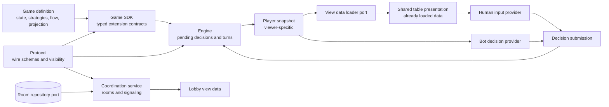
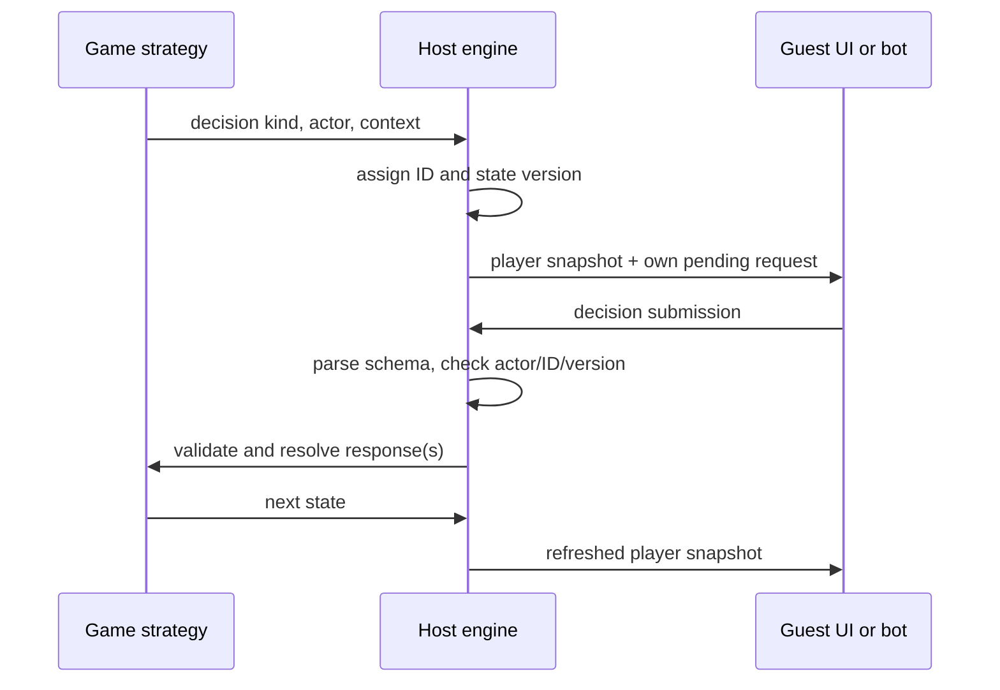
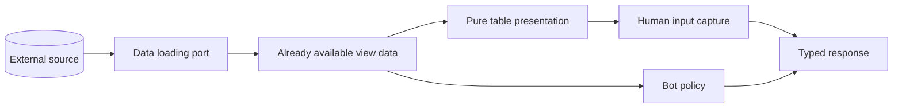

# Contract map

This is the entry point for reviewing the platform interfaces. The [JSON Schema](contracts.schema.json) describes the shared wire envelopes; each registered game supplies its own schemas for decision context, response, and player view. The [accepted architecture](superpowers/specs/2026-10-04-web-game-platform-design.md) explains the full product design.

## Ownership and relationships

The protocol is independent of the web framework, transport, and storage provider. AWS Lambda and DynamoDB implement the coordination ports later. The browser host runs the engine in the initial architecture; guests receive only projected snapshots. The UI presents data it has already received and captures a response. It does not retrieve game state or apply rules.

## Main areas

| Area | Owns | Depends on | Must not own |
| --- | --- | --- | --- |
| `packages/protocol` | Serializable decision, snapshot, room, signaling, and visibility contracts; runtime parsing | Zod | Game rules, rendering, persistence |
| `packages/game-sdk` | Typed game definition and strategy interfaces | Protocol | Turn orchestration, transport |
| `packages/engine` | Active decision groups, correlation, validation, response barriers, state versions, projection calls | SDK, protocol | A fixed list of game actions, UI |
| `services/coordination` | Room discovery and connection signaling through a repository port | Protocol | Hidden game state or rules |
| `packages/ui` | Render-ready table models and decision input/provider interfaces | Protocol | Room storage, authoritative state transitions |
| `apps/web` | Planned browser composition of these areas | Shared packages | Reimplementation of game rules |

## Decision and view protocol

`DecisionRequest<M>` is a discriminated union over a game's decision map `M`: each `kind` selects its own `context` type. `DecisionSubmission<M>` uses the same `kind` to select its `response` type. `createDecisionProtocol(codecs)` checks untrusted requests and submissions at runtime. A `PlayerSnapshot<M,V>` contains one viewer's projected `view` and only pending requests addressed to that viewer; `createSnapshotProtocol` verifies actor, table, and version correlation.

The JSON Schema records the shared envelope fields. Its generic `context`, `response`, and `view` fields are intentionally open: concrete game registrations provide their own Zod schemas. A complete game-specific wire schema can be exported when that game is registered. This avoids a platform-wide closed action enum.

## Lobby and signaling protocol

`RoomSummary` contains only public discovery metadata. `SignalMessage` carries an offer, answer, or ICE candidate addressed to one recipient in one room. The coordination service checks membership, recipient, expiry, and bounds before storing or returning messages. It never needs a game's private state. The initial AWS implementation will put an HTTP Lambda Function URL in front of the service and a DynamoDB adapter behind its repository port; these are deployment choices, not protocol dependencies.

## Data and input separation

Data retrieval is an adapter around a port. Presentation receives a loaded player snapshot and produces render-ready data; it does not fetch. Human controls and bot policies receive the same decision request contract and return the same submission contract. The engine alone decides whether a response is legal and how it changes state.

## How to inspect and maintain schemas

- Read [`docs/contracts.schema.json`](contracts.schema.json) for machine-readable shared message shapes.
- Read [`packages/protocol/src`](../packages/protocol/src) for generic TypeScript relations and runtime parsers.
- Run `npm run schema:export` after changing a shared Zod schema. `npm run check` verifies that the generated file is current.
- Run `npm test` for unit tests or `npm run check` for types, tests, and schema freshness. Pre-commit runs the latter for every commit.
